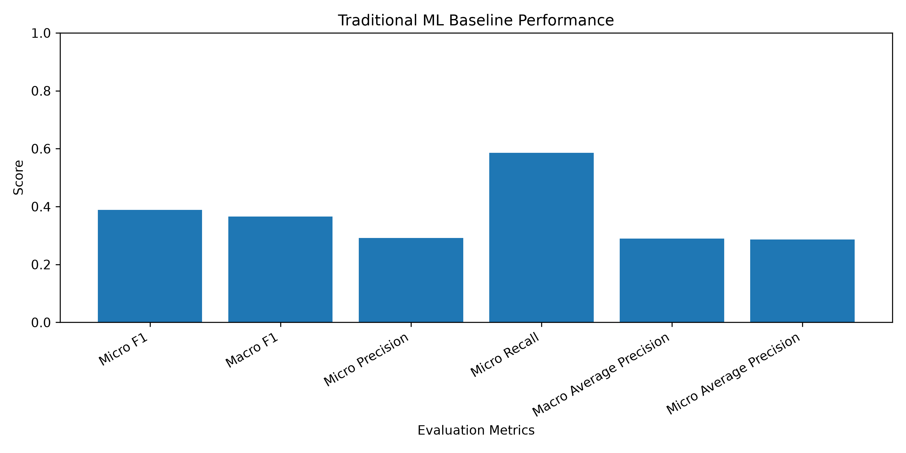
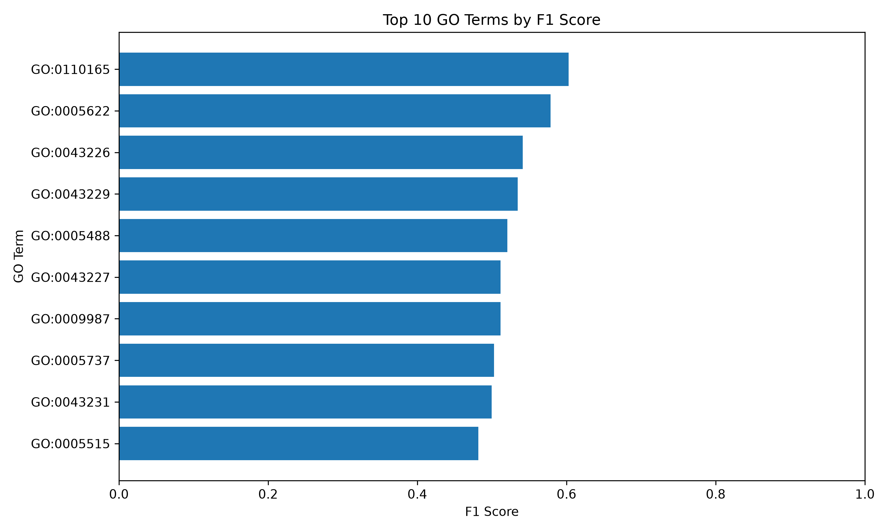

# AI for Protein Function Prediction Using Traditional Machine Learning

## Project Overview

This project explores how machine learning can predict protein functions from amino acid sequences.

Using the CAFA 5 dataset, I developed a traditional machine learning baseline that converts protein sequences into numerical amino acid composition features and uses Logistic Regression to predict selected Gene Ontology (GO) terms.

The goal is to establish a baseline and understand the strengths and limitations of traditional machine learning for protein function prediction.

## Research Question

How effectively can amino acid composition features predict selected Gene Ontology terms using Logistic Regression?

## Dataset

- **Source:** CAFA 5
- **Unique protein sequences:** 142,246
- **Selected GO terms:** 47
- **Training samples:** 113,796
- **Testing samples:** 28,450

## Methodology

1. Explored and prepared the CAFA 5 dataset.
2. Extracted 20 amino acid composition features from each protein sequence.
3. Prepared binary labels for 47 selected GO terms.
4. Split the dataset into training and testing sets using an 80/20 split.
5. Trained a Logistic Regression classifier using a One-vs-Rest strategy.
6. Evaluated the model using F1, precision, recall, and average precision.

## Baseline Results

| Evaluation Metric | Score |
|---|---:|
| Micro F1 | 0.3891 |
| Macro F1 | 0.3655 |
| Micro Precision | 0.2913 |
| Micro Recall | 0.5856 |
| Macro Average Precision | 0.2894 |
| Micro Average Precision | 0.2865 |

## Visualizations

### Overall Model Performance



### Top 10 GO Terms by F1 Score



## Project Structure

```text
protein-function-prediction/
├── data/
├── notebooks/
│   └── 01_data_exploration.ipynb
├── reports/
│   └── baseline_research_report.md
├── results/
│   ├── baseline_metrics.csv
│   ├── baseline_per_term_metrics.csv
│   ├── baseline_metrics_chart.png
│   └── top_10_go_terms.png
├── src/
└── README.md
```

## Key Findings

The baseline achieved a Micro F1 score of 0.3891 and a Micro Recall of 0.5856.

The results suggest that amino acid composition features provide useful information for protein function prediction. However, these features do not capture amino acid order or more complex sequence patterns, which limits their predictive ability.

## Future Work

- Explore pretrained protein language models such as ESM-2.
- Compare traditional amino acid composition features with learned protein representations.
- Experiment with additional machine learning models.
- Investigate ways to improve prediction performance.

## Technologies

- Python
- pandas
- NumPy
- scikit-learn
- Matplotlib
- Jupyter Notebook

## Author

A computer science student exploring machine learning, computational biology, and bioinformatics.